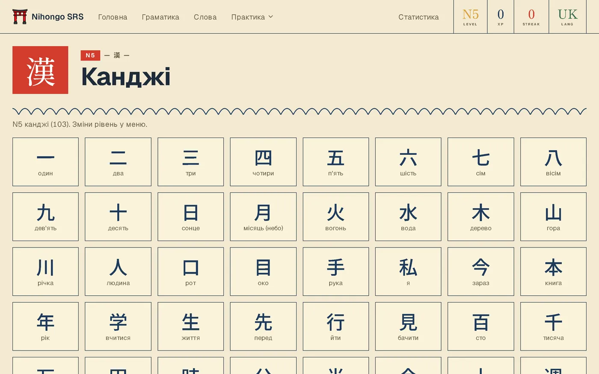
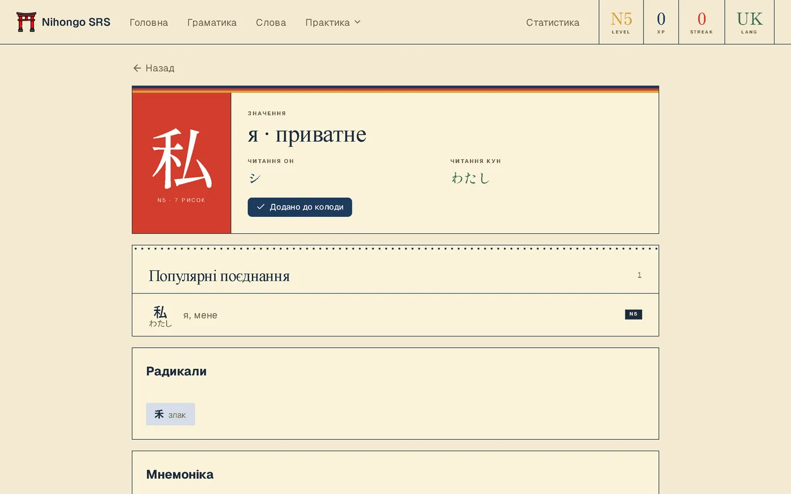
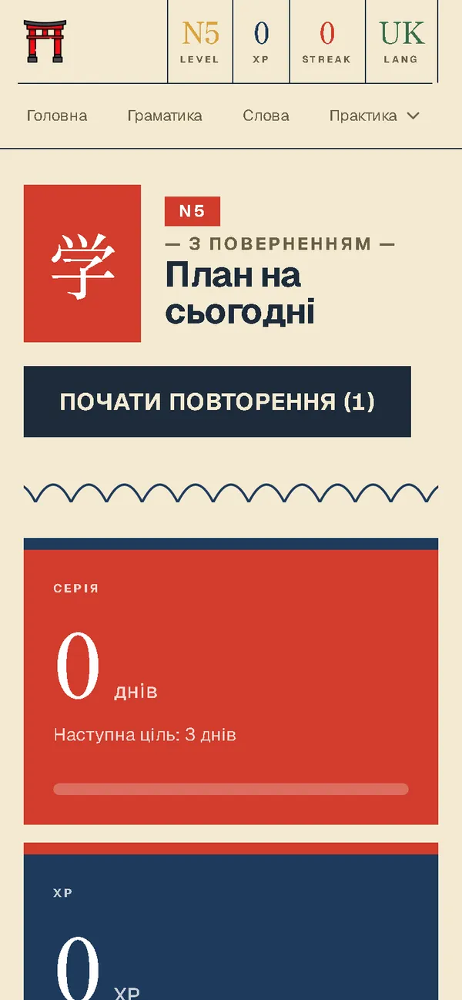

# Nihongo SRS: learn Japanese

A personal web app for learning Japanese with spaced repetition (SM-2), covering JLPT levels N5 to N1. The interface is available in English and Ukrainian.



## Features

- **SRS engine (SM-2).** Vocabulary, kanji and grammar all go through one Anki-style spaced repetition algorithm.
- **Grammar.** Theory, examples and quizzes for every topic. The course follows the lessons of Genki 1 and Genki 2.
- **Vocabulary** by JLPT level. One click adds a word to the study queue.
- **Kanji** with a mnemonic editor and a breakdown by radicals.
- **Listening** and **reading** exercises with comprehension questions. Audio uses the Web Speech API (or Tatoeba when available).
- **Furigana** is shown automatically above kanji in review cards and word lists.
- **Gamification:** XP, daily streak, daily goal, achievements.
- **Statistics:** a 12-week activity heatmap, progress per JLPT level, unlocked achievements.
- **JLPT level switcher** in the navbar. The selected level applies to every section at once.
- **Responsive layout:** works from a 320 px phone screen up to a wide desktop.

| Kanji card | Phone |
|---|---|
|  |  |

## Stack

- **Next.js 16** (App Router) + **TypeScript** + **Tailwind CSS v4**
- **Prisma 7** + **better-sqlite3** (SQLite locally; switches to PostgreSQL in production via `DATABASE_URL`)
- **Vitest** for SM-2 unit tests
- shadcn/ui-style components + lucide icons
- Ukiyo-e inspired palette: vermilion, indigo, ochre and pine on a warm paper background

## Running locally

```bash
npm install
npm run db:migrate           # creates the SQLite database and applies migrations
npm run seed                 # N5 starter set (radicals, kanji, words, grammar, listening, reading)
npm run seed:genki           # curated Genki 1+2: 44 grammar points + 88 words
npm run seed:vocab           # extended vocabulary (~300 words, N5/N4/N3)
npm run seed:n5              # full N5 set: 101 kanji + ~210 words
npm run seed:radicals        # radicals + kanji breakdown by radical
npm run seed:n5:more         # more N5: kanji 車/休 + ~90 words
npm run seed:vocab:more      # ~90 more words, N5/N4/N3 (seasons, verbs, adverbs)
npm run seed:content:v3      # 12 listening + 15 reading exercises for N5/N4/N3 (replaces older ones)
npm run seed:content:extra   # 9 more listening + 10 reading exercises for N4/N3
npm run seed:examples        # ~157 example sentences for the dictionary
npm run translate:uk         # fill in the Ukrainian fields (dictionaries)
npm run translate:uk:extra   # second pass: mnemonics, grammar explanations, listening/reading
npm run translate:uk:exercises # exercise text (prompts, explanations) + dictionary examples
npm run dev
```

Open <http://localhost:3000>.

## Moving to another Windows PC

The repository root contains `setup.bat` + `setup.ps1`. Double-clicking `setup.bat` brings the project up on a clean PC from scratch.

### What setup.ps1 does

1. Checks that `node` / `npm` are installed
2. `npm install`
3. Creates `.env` with `DATABASE_URL` if it is missing
4. `npx prisma generate` + `npx prisma migrate deploy`
5. If `dev.db` has already been copied, skips seeding (keeps your SRS progress).
   If `dev.db` is missing, runs all seeders in order
6. `npm run dev` → the site runs at `http://localhost:3000`

### Step by step

**To keep your SRS progress** (reviews, XP, streak):

1. On the old PC, copy the whole project folder **except** `node_modules` and `.next` (they are large and get recreated)
2. Make sure `dev.db` in the repository root was copied too. It holds all of your progress
3. Move the folder to the new PC (USB drive, archive, OneDrive)
4. Install [Node.js LTS](https://nodejs.org) (once; it provides `node` and `npm`)
5. Double-click `setup.bat` in the copied folder
6. Wait for `Site will be available at http://localhost:3000` and open it in a browser

**If you don't need the progress**, just clone the repository:

```powershell
git clone https://github.com/Mariia157/japanese-study-web.git
cd japanese-study-web
.\setup.bat
```

`dev.db` will be missing, so the script runs every seeder automatically (~3–5 minutes on the first run).

### If PowerShell complains about the execution policy

`setup.bat` already passes `-ExecutionPolicy Bypass`, so you don't need to change anything by hand. If it is still required, run this once in an admin PowerShell:

```powershell
Set-ExecutionPolicy -Scope CurrentUser RemoteSigned
```

### Subsequent runs

Run `npm run dev` from the project folder (or double-click `setup.bat` again: it checks dependencies in a couple of seconds and starts the server).

## Architecture

```
src/
  app/
    page.tsx                  # dashboard: streak, XP, due reviews, daily goal
    review/                   # /review: SRS session with Again/Hard/Good/Easy buttons
    grammar/                  # grammar list for the current JLPT level + detail page by slug
    vocabulary/               # vocabulary for the current level
    kanji/                    # kanji for the current level + detail page per character
    listening/, reading/      # listening and reading exercises
    stats/                    # heatmap, progress, achievements
    api/
      srs/queue                # GET: cards due today
      srs/review               # POST: grade a card 1–4 → scheduling + XP
      srs/add                  # POST: add an item to the SRS queue
      level                    # POST: change the JLPT level (cookie)
      locale                   # POST: change the interface language (cookie)
      kanji/[id]/mnemonic      # POST: save a mnemonic
  components/
    Nav.tsx, LevelSwitcher.tsx, LocaleSwitcher.tsx
    Furigana.tsx               # ruby annotations for kanji
    srs/ReviewSession.tsx      # review card
    grammar/QuizBlock.tsx      # quizzes
    kanji/MnemonicEditor.tsx   # mnemonic editor
    listening/, reading/       # exercises
    ui/                        # Card, Button, Progress
  lib/
    srs/sm2.ts                 # SM-2 algorithm (with unit tests)
    srs/queue.ts               # builds the review queue
    xp.ts                      # XP, streaks, achievements
    level.ts                   # current JLPT level from a cookie
    db.ts                      # Prisma client (singleton + SQLite adapter)
prisma/
  schema.prisma                # all models
scripts/
  seed-starter.ts              # minimal N5 set to get started
  seed-genki.ts                # curated Genki 1+2 structure (grammar + words)
  import-genki.ts              # Genki PDF parser (only works with PDFs that have a text layer)
```

## SM-2 logic

`src/lib/srs/sm2.ts` is a pure function with grades 1–4:

- **1 (Again)** resets the repetition count; the card comes back in 1 day
- **2 (Hard)** multiplies the interval by 0.6
- **3 (Good)** uses the standard interval: 1 → 6 → 6×EF → 6×EF² ...
- **4 (Easy)** multiplies the interval by 1.3 and raises the ease factor

The ease factor never drops below 1.3. All 6 test cases in `sm2.test.ts` pass.

## Database

Uses **SQLite** locally (the `dev.db` file in the repository root; the path is set in `.env` as `DATABASE_URL="file:./dev.db"`). Arrays and JSON are stored as JSON strings for SQLite compatibility.

Key models: `Kanji`, `Radical`, `Vocabulary`, `GrammarPoint`, `GrammarExercise`, `ListeningExercise`, `ReadingExercise`, `SrsCard`, `ReviewLog`, `UserStats`, `Achievement`.

To deploy on Vercel, change `provider = "sqlite"` to `"postgresql"` in `prisma/schema.prisma`, add a Postgres `DATABASE_URL` and run `prisma migrate deploy`.

### Accessing the database

**1. Prisma Studio**: a visual browser with filters and editing
```powershell
npm run db:studio
```
It opens `http://localhost:5555`.

**2. SQLite CLI** (if `sqlite3` is installed)
```powershell
sqlite3 dev.db
.tables
SELECT word, reading, jlptLevel FROM Vocabulary LIMIT 10;
.exit
```

**3. A GUI client**: open `dev.db` in
- [DB Browser for SQLite](https://sqlitebrowser.org/), free and handy for browsing
- DBeaver / TablePlus / DataGrip

**4. A one-off query through Prisma**
```ts
// scripts/query.ts
import { PrismaClient } from "@prisma/client";
import { PrismaBetterSqlite3 } from "@prisma/adapter-better-sqlite3";
const db = new PrismaClient({ adapter: new PrismaBetterSqlite3({ url: "./dev.db" }) });
const rows = await db.vocabulary.findMany({ where: { jlptLevel: 3 }, take: 10 });
console.log(rows);
await db.$disconnect();
```
Run it with `npx tsx scripts/query.ts`.

## Content sources

- **Starter set (`npm run seed`):** 15 radicals, 30 N5 kanji (with ready-made mnemonics), 30 basic words, 5 N5 grammar patterns, listening/reading samples
- **Genki track (`npm run seed:genki`):** 44 grammar points across the 23 lessons of Genki 1+2 + 88 words, linked to lessons via `source: "genki-L<n>"`. The content is written by hand, based on the well-known structure of the textbook
- **PDF parser (`npm run seed:genki:pdf -- --book=1|2 --textbook=<path>`):** for PDFs with a text layer; scanned images are not parsed

> **Note:** Genki is a commercial textbook. No PDFs are included in this repository. Use only your own legally purchased copies for personal study.

## Deploying to Vercel

1. Push the repository to GitHub
2. Create a Vercel project and connect Vercel Postgres (or Neon)
3. In `prisma/schema.prisma`, change `provider` from `sqlite` to `postgresql`
4. Set `DATABASE_URL` in the Vercel environment variables
5. Build command: `prisma migrate deploy && next build`
6. (Recommended) add Basic Auth middleware (`src/middleware.ts`), especially if the database contains content derived from Genki

## Scripts

| Command | Description |
|---|---|
| `npm run dev` | Start the Turbopack dev server |
| `npm run build` | Production build |
| `npm test` | SM-2 unit tests (Vitest) |
| `npm run db:migrate` | Apply Prisma migrations |
| `npm run db:studio` | Prisma Studio (visual database browser) |
| `npm run seed` | Starter content (N5: radicals, kanji, words, grammar) |
| `npm run seed:genki` | Curated Genki 1+2: 44 grammar points |
| `npm run seed:vocab` | Extended vocabulary (~300 words, N5/N4/N3) |
| `npm run seed:n5` | Full N5 set: 101 kanji + ~210 words (with mnemonics and radicals) |
| `npm run seed:radicals` | Extra radicals + linking kanji to radicals |
| `npm run seed:n5:more` | More N5: kanji 車/休 + ~90 words (colors, body, time, questions, adverbs) |
| `npm run seed:vocab:more` | ~90 more words, N5/N4/N3 (seasons, nature, verbs, adjectives, adverbs) |
| `npm run seed:content:v3` | Listening + reading with images (replaces existing ones) |
| `npm run seed:content:extra` | Additional N4/N3 listening + reading |
| `npm run seed:examples` | Example sentences for the dictionary |
| `npm run seed:explanations` | Detailed grammar explanations |
| `npm run translate:uk` | Fill in the Ukrainian fields from the English ones (dictionaries) |
| `npm run translate:uk:extra` | Second pass: kanji mnemonics, grammar explanations and examples, listening/reading |
| `npm run translate:uk:exercises` | Grammar exercise text (prompts, explanations) + dictionary example sentences |
| `npm run seed:genki:pdf` | Import a PDF (if it has a text layer) |

## License

Personal project. Feel free to use the code however you like. The learning content in `scripts/seed-starter.ts` is common knowledge about Japanese, with no copyright. The content in `scripts/seed-genki.ts` retells the structure of Genki in my own words for personal study. Textbook PDFs are not part of the repository.
